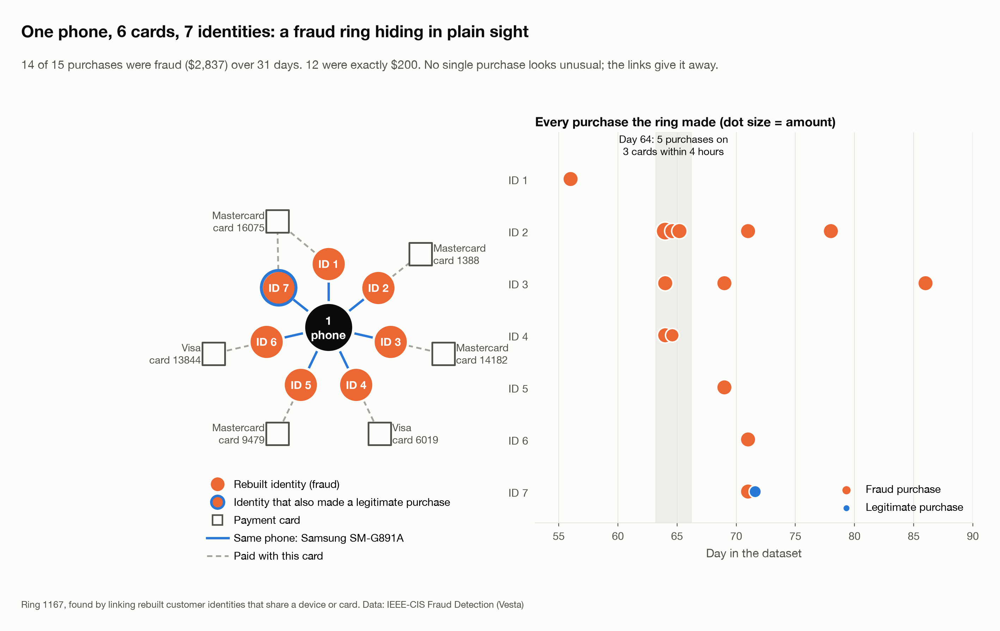
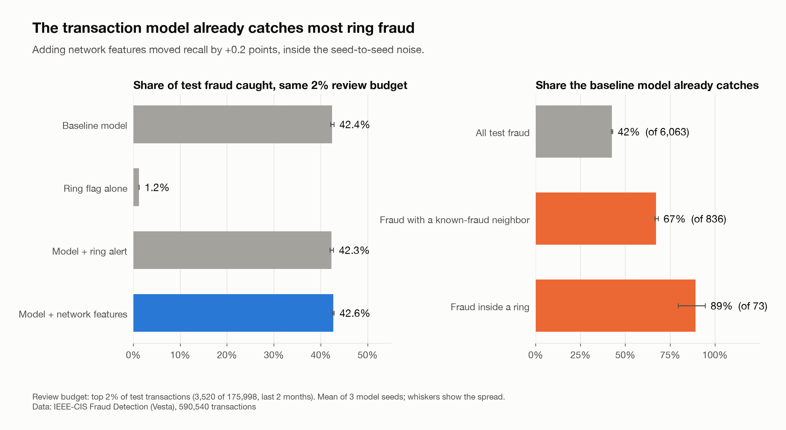
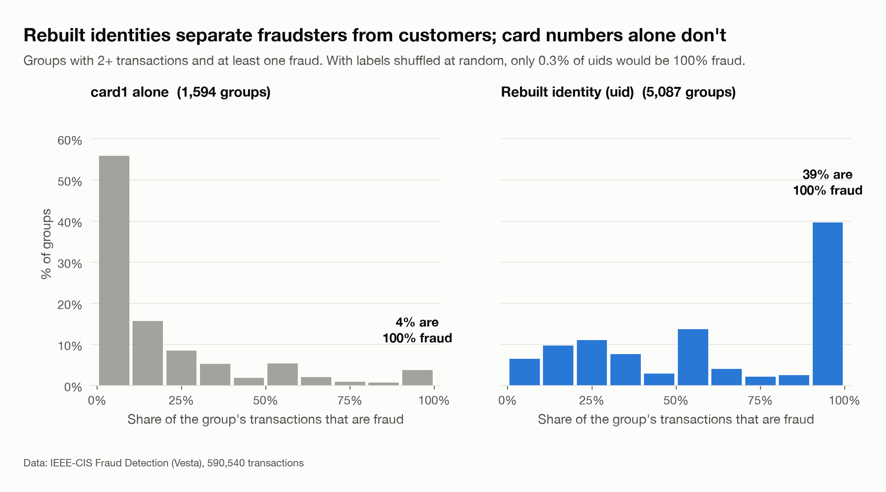
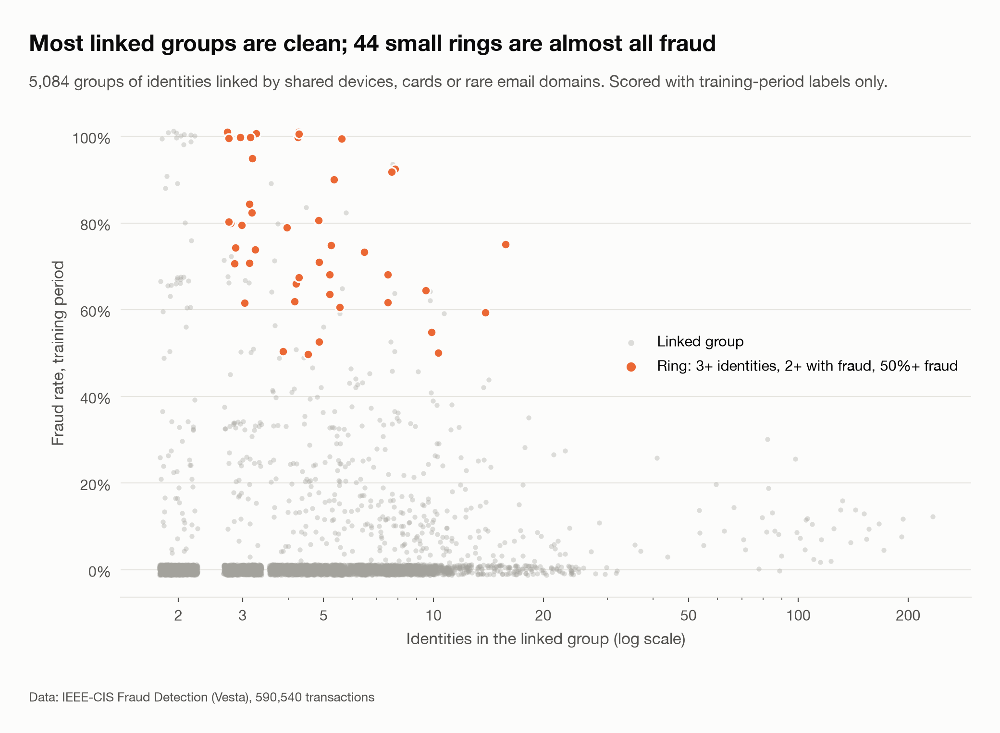
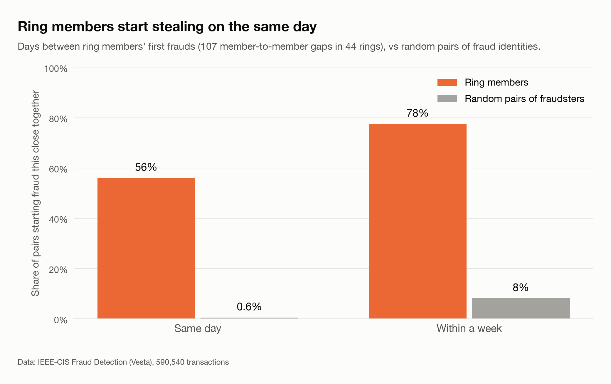

# Fraud Ring Hunter

**Fraud rings are real, but a strong transaction model already catches 89% of their fraud. Adding network features moved recall by just +0.2 points, inside the noise.**

I rebuilt hidden customer identities from 590,000 anonymized payments, linked them into a network, and found 44 fraud rings. Then I tested whether the ring view catches fraud a normal model misses, at the same review budget. It caught 3.5% of the fraud the model missed ($25K), but displaced about as many catches as it added. The honest answer is that, on this data, a graph pipeline would add cost without catching more fraud.



## The question

Fraud models judge one transaction at a time, but fraudsters often work in groups: one phone, many cards, many fake customers. **If you link customers who share a device or card, do you catch fraud that a transaction-level model misses?**

## Key findings

- **Rings exist.** Linking rebuilt identities by shared phones and cards surfaced **44 rings** (225 identities) whose transactions are **71% fraud**, against a 3.5% base rate. They were found using training-period labels only, and stayed **64% fraud** in the later test period.
- **Ring members move in lockstep.** **56%** of ring members start their fraud on the same day as another member, against **0.6%** for random pairs of fraudsters. A third of rings do all their damage in a single day.
- **Each fake identity is used once or twice.** The median ring member commits **1** fraud transaction, and on average 67% of a ring's links come from a **shared device**.
- **The transaction model already sees the rings.** Within a 2% review budget it flags **89%** of ring fraud and **67%** of fraud with a known-fraud neighbor, against 42% of fraud overall.
- **So the network adds almost nothing.** Recall went from **42.4% to 42.6%** (3 seeds, std 0.35 and 0.15 points). Net gain: **+14 fraud transactions, plus or minus 13**.



**Why it matters:** the rigorous comparison is the result. It stopped a graph system that would add cost, latency and alert volume for no net gain. The rings still earn their keep as an investigation tool, because they explain *why* a cluster of transactions is fraud.

## How it works

**1. Rebuild the customers.** The data has no customer ID. But column `D1` counts days since the account opened, so `day - D1` is a start date that stays fixed for the same customer. Card + billing region + start date gives a rebuilt identity. It checks out: among identities that contain any fraud, **39% are entirely fraud**, against 3.6% when grouping by card alone and 0.3% with shuffled labels.



**2. Set a fair baseline.** A LightGBM model on the transaction fields plus velocity features written in DuckDB SQL (activity in the last hour, day and week; distinct devices and emails; amount versus the customer's usual). Trained on the first 4 months and tested on the last 2, never a random split. Every method gets the same budget: review the top **2%** of test transactions (3,520 of 175,998). The baseline catches **42%** of test fraud at **73%** precision (AUC 0.92).

**3. Connect the identities and find rings.** Identities become nodes, and shared device fingerprints, cards or rare email domains become edges. Any value shared by more than 10 identities is dropped (hub suppression), so "Windows" or "gmail.com" cannot glue strangers together. Connected components and Louvain community detection give the clusters, which are scored with **training-period labels only**.



**4. Compare at the same budget.** Four ways to fill the same review queue: the baseline, a ring flag alone, ring alerts first, and the baseline retrained with 11 network features. The features are computed **as of** each transaction's date: a link counts only once both sides have shown it, neighbor labels stop at the end of training, and a customer's own labels are never used.

| Approach (2% review budget, 3 seeds) | Fraud caught | Recall | Fraud dollars caught | Precision |
|---|---|---|---|---|
| Baseline model | 2,572 | 42.4% | $339K | 73.1% |
| Ring flag alone | 73 | 1.2% | $5K | 64.0% |
| Model + ring alerts first | 2,564 | 42.3% | $335K | 72.8% |
| **Model + network features** | **2,585** | **42.6%** | **$341K** | **73.4%** |

**5. Look at what rings do.** Beyond the headline, the timing tells the story: ring members start together, burn through identities and go quiet.



## Where this pattern shows up

The "one actor, many identities" shape appears well beyond card fraud:

- **Free-trial abuse:** one person signs up again and again with new emails. Shared devices and payment fingerprints link the accounts.
- **Card testing at checkout:** bots run stolen cards through small purchases from the same devices to find the ones that work.
- **Promo and referral abuse:** fake accounts refer each other to farm credits, forming tight clusters that join within days of each other.
- **Marketplace seller rings:** colluding sellers and buyers share bank accounts, addresses or devices.
- **Fake signups and bot farms:** bursts of new accounts from a handful of devices.

The lessons carry over: suppress hub values, score clusters only with labels you would have had at the time, and test the network against a strong baseline at a fixed budget before building it.

## Limits

- **Identities are approximate.** `card + region + start date` is a reconstruction, not a true customer ID.
- **The data is anonymized.** Most columns are masked, so products and many fields cannot be interpreted.
- **Linkers are partial.** Device data covers only 24% of transactions, and none of product W (75% of traffic). IP addresses, shipping addresses or bank accounts might reveal rings the model cannot see.
- **Labels spread after detection.** Vesta marks a customer's later transactions as fraud once caught, which makes identities look purer than they would in live use.
- **Small numbers.** 44 rings and 114 test-period ring transactions, 53 of them from a single ring.
- **One dataset, one budget.** "Rings are redundant" holds for this model on this data at 2%. A weaker model or a different budget could change it.

## How to run

1. Accept the competition rules at [kaggle.com/c/ieee-fraud-detection](https://www.kaggle.com/c/ieee-fraud-detection), then download the data manually or with your own API key:

```bash
kaggle competitions download -c ieee-fraud-detection -p data/raw
```

2. Unzip it so `data/raw/` contains `train_transaction.csv` and `train_identity.csv` (only the `train_*` files are used; the test files have no labels).

3. Set up the environment (Python 3.10+; on macOS the script also fixes LightGBM's OpenMP link):

```bash
bash scripts/setup_env.sh
```

4. Build everything (parquet, identities, features, models, network, comparison, figures). Steps that are already done are skipped; `--force` rebuilds all of them:

```bash
.venv/bin/python src/pipeline.py
```

5. Open the story notebook, [`notebooks/fraud_ring_hunter.ipynb`](notebooks/fraud_ring_hunter.ipynb).

```
sql/          DuckDB queries: load, identities, velocity features, edges, as-of network features
src/          identity, features, model, graph, compare, patterns, hero, viz, pipeline
notebooks/    fraud_ring_hunter.ipynb (the story) and 00_scratch/ (one working notebook per phase)
figures/      the charts above
```

Stack: Python, DuckDB (SQL feature engineering), LightGBM, SHAP, networkx (Louvain), pandas, matplotlib.

## About

**Kean Zhu**, MS Business Analytics, Boston University.

Data: [IEEE-CIS Fraud Detection](https://www.kaggle.com/c/ieee-fraud-detection), provided by Vesta Corporation. The data is not included in this repository.
